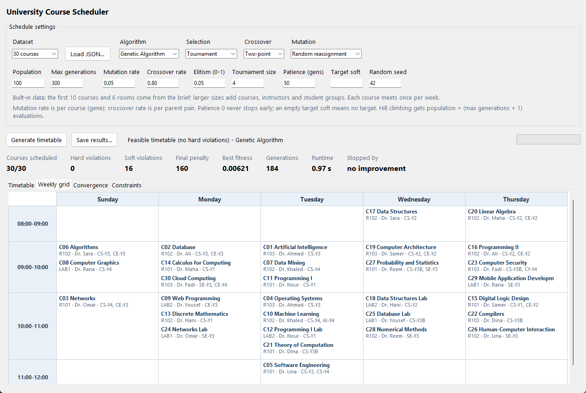
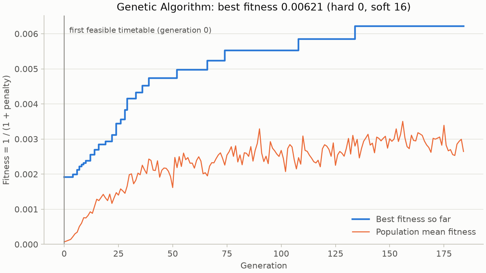
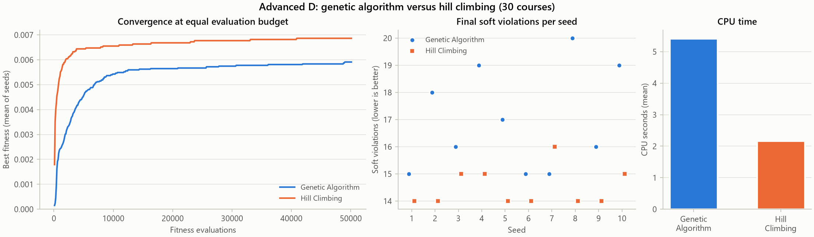
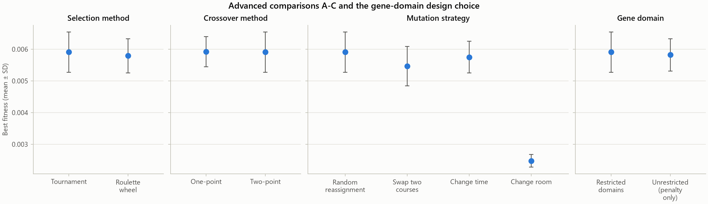
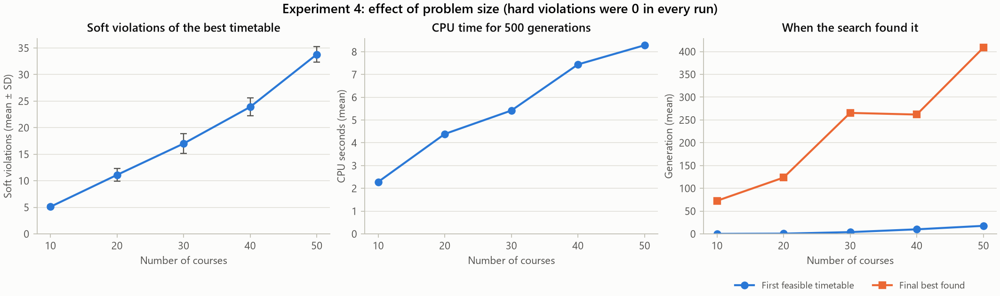

<div align="center">

# University Course Scheduler

### Build, inspect, and compare university timetables.

A genetic algorithm scheduler with a desktop interface, command-line tools, and reproducible experiments.


[Quick start](#quick-start) · [Screenshots & results](#screenshots--results) · [Experiments](#tests-and-experiments) · [Project report](docs/COMP338_Report.pdf)



*A 30-course timetable with zero hard-constraint violations, displayed in the weekly grid.*

</div>

## Overview

Created for COMP338, this project assigns courses to rooms and weekly time slots while evaluating scheduling conflicts and preferences. Generate a schedule, inspect its constraint violations and convergence, and export the results for review.

| Capability | What you can do |
| :--- | :--- |
| Desktop interface | Configure a run and inspect timetable, weekly grid, convergence, and constraints tabs. |
| Two search algorithms | Run a genetic algorithm or compare it with a hill-climbing baseline. |
| Configurable operators | Compare tournament and roulette selection, one- and two-point crossover, and four mutation strategies. |
| Constraint evaluation | Check room, instructor, and student-group conflicts, capacity, room type, and availability. |
| Sample and custom data | Start with 10–50 course examples or load a JSON dataset. |
| Portable exports | Save HTML and CSV timetables, JSON results, and convergence data and plots. |

## Quick start

Requires **Python 3.10+**. Clone the repository and create an environment:

```sh
git clone https://github.com/Brawly0/comp338-course-scheduler.git
cd comp338-course-scheduler
python -m venv .venv
```

Activate on Windows PowerShell:

```powershell
.venv\Scripts\Activate.ps1
```

Or on macOS / Linux:

```sh
source .venv/bin/activate
```

Install dependencies:

```sh
python -m pip install -r requirements.txt
```

The scheduling engine uses the Python standard library; Matplotlib supplies plots for exports and experiments. The desktop app requires Tkinter, included with many Python installations. Linux distributions may provide it separately as `python3-tk`. Cloning this private repository requires GitHub access.

Run the remaining commands from the repository root.

## Run

Open the desktop interface:

```sh
python main.py
```

Generate a timetable in the terminal:

```sh
python main.py --cli --data data/sample_30.json --seed 42
```

Export a run to a new folder:

```sh
python main.py --cli --courses 20 --save results/my_run
```

Compare with hill climbing:

```sh
python main.py --cli --courses 20 --algorithm hill
```

See all options with `python main.py --help`.

## Screenshots & results

### Desktop scheduling workspace

The [full-size screenshot](docs/screenshots/scheduler-overview.png) above shows the real application settings, a completed run, and the weekly timetable. The interface also provides a course table, convergence view, and constraint breakdown.

### Convergence of the saved demo



The [included demo](results/demo/) schedules **30 courses** with **0 hard violations** and **16 soft violations**, stopping after **184 generations** without further improvement. These are recorded results from one seeded run.

[HTML export](results/demo/timetable.html) · [CSV timetable](results/demo/timetable.csv) · [Full JSON result](results/demo/result.json)

Download the HTML file and open it in a browser to see the rendered timetable; GitHub displays its source.

### Genetic algorithm vs. hill climbing



The recorded comparison uses **30 courses**, **10 seeds**, and an equal budget of **50,100 evaluations per run**. Both algorithms reached zero hard violations in all ten runs. Hill climbing achieved a lower mean soft-violation count in this experiment. See the [raw comparison data](results/experiments/algorithm_comparison.csv) and [experimental report](results/experiments/REPORT.md) for context.

<details>
<summary><strong>Explore operator comparisons and dataset scaling</strong></summary>

#### Selection, crossover, and mutation



#### Scaling from 10 to 50 courses



All figures come from the included experiment outputs. Open the [experimental report](results/experiments/REPORT.md) for settings and measurements.

</details>

## How scheduling works

1. **Load a problem.** Define days, periods, rooms, instructors, courses, and student groups in JSON, or select a built-in example.
2. **Search for a schedule.** The genetic algorithm evolves course assignments using selection, crossover, mutation, and elitism. Hill climbing provides an alternative baseline.
3. **Evaluate constraints.** The objective prioritizes hard constraints, then improves soft preferences such as student gaps and instructor preferences.
4. **Inspect and export.** Review the timetable and violation counts, then save the outputs.

## Tests and experiments

Run the existing unit tests:

```sh
python -m unittest -v
```

Run a short experiment pipeline into a separate folder:

```sh
python experiments.py --quick --output results/quick_run
```

The full study uses ten seeds and 500 generations by default. Save new runs separately to preserve the included results:

```sh
python experiments.py --output results/full_run
```

## Repository guide

```text
.
├── main.py                 # Algorithms, evaluation, desktop UI, and exports
├── experiments.py          # Parameter studies and algorithm comparisons
├── test_project.py         # Regression tests
├── requirements.txt        # Plotting dependency
├── data/                   # Sample datasets: 10, 20, 30, 40, and 50 courses
├── docs/
│   ├── screenshots/        # Desktop screenshot and visual reference guide
│   ├── figures/            # Original report illustration
│   ├── COMP338_Report.pdf  # Full project report
│   └── COMP338_Report.docx # Editable report
└── results/
    ├── demo/               # Example timetable and convergence outputs
    └── experiments/        # Recorded studies, figures, and raw measurements
```

## Documentation

- [Project report (PDF)](docs/COMP338_Report.pdf)
- [Editable report (Word)](docs/COMP338_Report.docx)
- [Experimental results and methodology](results/experiments/REPORT.md)
- [Screenshot and visual reference guide](docs/screenshots/README.md)
- [Example JSON dataset](data/sample_30.json)

Optimization is stochastic. Seeds make runs reproducible within the same implementation, but the algorithms do not guarantee a globally optimal timetable.
