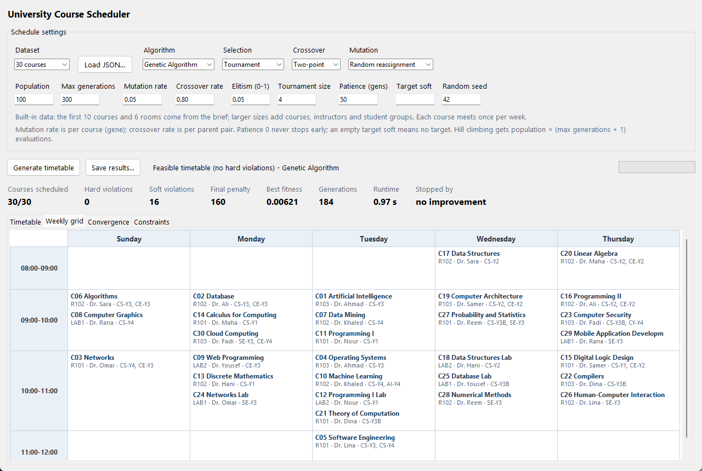

# Screenshots and visual references

## Desktop application

The screenshot shows the real Tkinter application with algorithm settings, run metrics, and the weekly-grid tab. It is copied without modification from the project's original [report screenshot](../figures/gui_weekly_grid.png).

The displayed run schedules 30 courses with zero hard violations and 16 soft violations. Runtime and stopping settings shown here belong to the captured run; they may differ from separately saved demo outputs.

## Generated result figures

These are plots generated by the project, rather than screenshots of the desktop interface.

| Visual | Source |
| :--- | :--- |
| Demo convergence | [Open figure](../../results/demo/convergence.png) |
| Genetic algorithm vs. hill climbing | [Open figure](../../results/experiments/ga_vs_hill_climbing.png) |
| Operator comparison | [Open figure](../../results/experiments/operator_comparison.png) |
| Dataset scaling | [Open figure](../../results/experiments/size_scaling.png) |

See the [experimental report](../../results/experiments/REPORT.md) for the settings and measurements behind the experiment figures.
