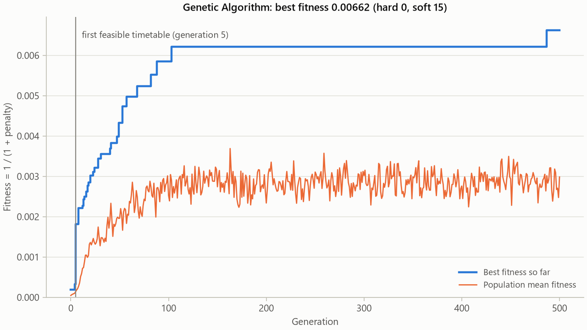
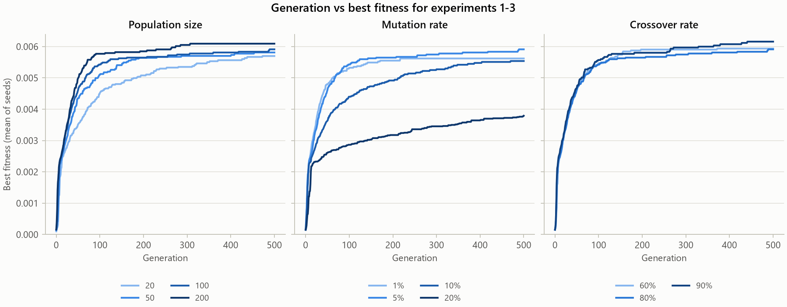
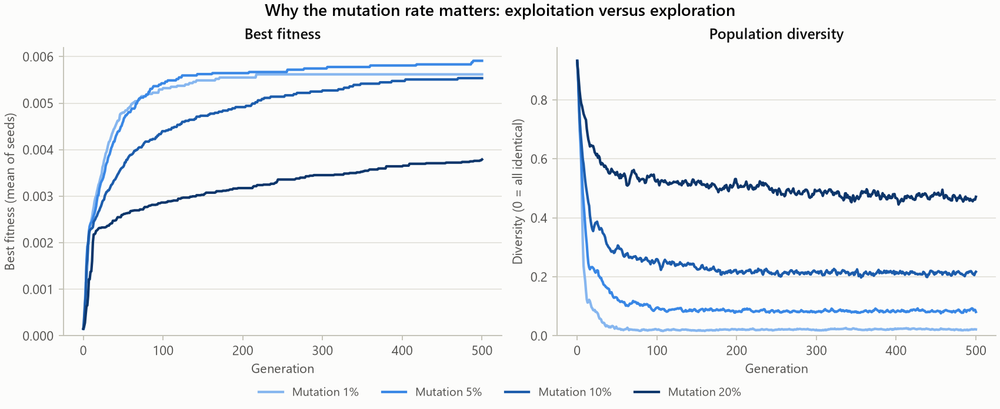
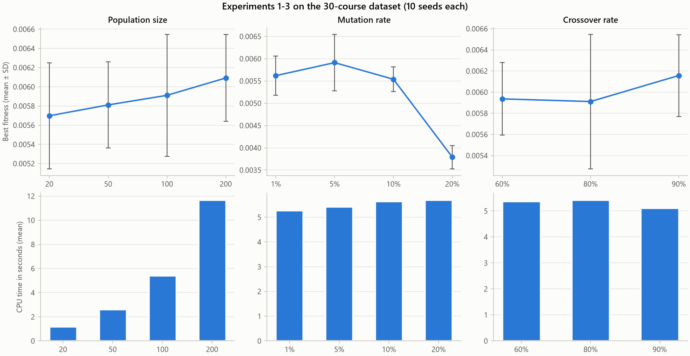
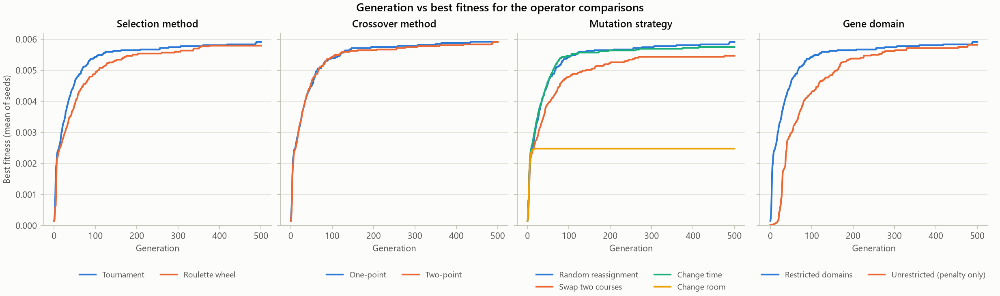
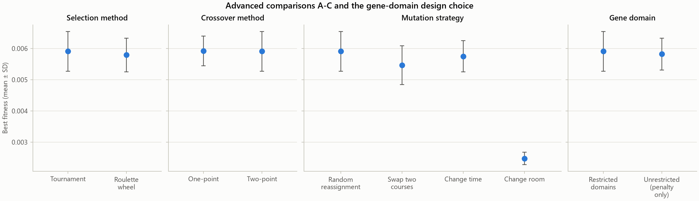
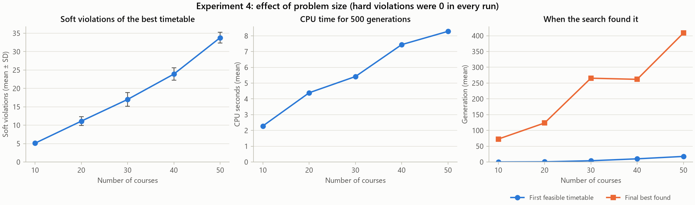
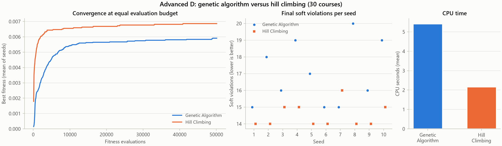

# Experimental results

Measured runs on Windows-11-10.0.26200-SP0 with Python 3.14.3. Seeds [1, 2, 3, 4, 5, 6, 7, 8, 9, 10]; 500 generations per run; 210 distinct GA runs and 10 hill-climbing runs took 29.3 minutes.

Baseline: 30 courses, population 100, mutation 0.05 per gene, crossover 0.8 per pair, tournament selection (size 4), two-point crossover, random mutation, 5% elitism. One factor changes at a time. Stagnation stopping is off, so every run uses the full budget. Runs that appear in several studies (the baseline) are executed once and reused.

"Best found at gen." is the first generation that reached the run's final best penalty; "first feasible" is the first generation with zero hard violations. Diversity is the share of genes that differ from the most common gene at the same position in the final population. Runtime is the CPU time of the Python process (time.process_time), so other programs running at the same time do not inflate it.

## Experiment 1: population size

| Value | Best fitness (mean ± SD) | Soft (mean ± SD) | Best / worst soft | Hard (mean) | Feasible | First feasible gen. | Best found at gen. | Final diversity | CPU s |
|---|---:|---:|---:|---:|---:|---:|---:|---:|---:|
| 20 | 0.00570 ± 0.00055 | 17.6 ± 1.7 | 15 / 20 | 0.00 | 100% | 7.6 | 351 | 0.077 | 1.19 |
| 50 | 0.00581 ± 0.00045 | 17.2 ± 1.3 | 15 / 19 | 0.00 | 100% | 5.6 | 251 | 0.080 | 2.61 |
| 100 | 0.00591 ± 0.00064 | 17.0 ± 1.9 | 15 / 20 | 0.00 | 100% | 3.9 | 265 | 0.081 | 5.42 |
| 200 | 0.00609 ± 0.00045 | 16.4 ± 1.3 | 15 / 19 | 0.00 | 100% | 3.3 | 155 | 0.095 | 11.68 |

Lowest mean soft penalty: 200 (16.4); highest: 20 (17.6).

## Experiment 2: mutation rate

| Value | Best fitness (mean ± SD) | Soft (mean ± SD) | Best / worst soft | Hard (mean) | Feasible | First feasible gen. | Best found at gen. | Final diversity | CPU s |
|---|---:|---:|---:|---:|---:|---:|---:|---:|---:|
| 1% | 0.00562 ± 0.00044 | 17.8 ± 1.5 | 16 / 21 | 0.00 | 100% | 4.2 | 142 | 0.022 | 5.28 |
| 5% | 0.00591 ± 0.00064 | 17.0 ± 1.9 | 15 / 20 | 0.00 | 100% | 3.9 | 265 | 0.081 | 5.42 |
| 10% | 0.00554 ± 0.00028 | 18.0 ± 0.9 | 17 / 20 | 0.00 | 100% | 4.1 | 329 | 0.217 | 5.64 |
| 20% | 0.00379 ± 0.00026 | 26.4 ± 1.8 | 24 / 29 | 0.00 | 100% | 8.4 | 433 | 0.472 | 5.70 |

Lowest mean soft penalty: 5% (17.0); highest: 20% (26.4).

## Experiment 3: crossover rate

| Value | Best fitness (mean ± SD) | Soft (mean ± SD) | Best / worst soft | Hard (mean) | Feasible | First feasible gen. | Best found at gen. | Final diversity | CPU s |
|---|---:|---:|---:|---:|---:|---:|---:|---:|---:|
| 60% | 0.00594 ± 0.00034 | 16.8 ± 1.0 | 16 / 19 | 0.00 | 100% | 5.1 | 153 | 0.091 | 5.37 |
| 80% | 0.00591 ± 0.00064 | 17.0 ± 1.9 | 15 / 20 | 0.00 | 100% | 3.9 | 265 | 0.081 | 5.42 |
| 90% | 0.00616 ± 0.00039 | 16.2 ± 1.0 | 15 / 18 | 0.00 | 100% | 3.7 | 293 | 0.089 | 5.11 |

Lowest mean soft penalty: 90% (16.2); highest: 80% (17.0).

## Experiment 4: dataset size

| Value | Best fitness (mean ± SD) | Soft (mean ± SD) | Best / worst soft | Hard (mean) | Feasible | First feasible gen. | Best found at gen. | Final diversity | CPU s |
|---|---:|---:|---:|---:|---:|---:|---:|---:|---:|
| 10 courses | 0.01929 ± 0.00102 | 5.1 ± 0.3 | 5 / 6 | 0.00 | 100% | 0.0 | 73 | 0.094 | 2.28 |
| 20 courses | 0.00901 ± 0.00086 | 11.1 ± 1.2 | 10 / 14 | 0.00 | 100% | 0.5 | 124 | 0.081 | 4.39 |
| 30 courses | 0.00591 ± 0.00064 | 17.0 ± 1.9 | 15 / 20 | 0.00 | 100% | 3.9 | 265 | 0.081 | 5.42 |
| 40 courses | 0.00418 ± 0.00029 | 23.9 ± 1.7 | 21 / 27 | 0.00 | 100% | 10.0 | 262 | 0.089 | 7.44 |
| 50 courses | 0.00296 ± 0.00013 | 33.8 ± 1.5 | 31 / 36 | 0.00 | 100% | 17.6 | 408 | 0.099 | 8.29 |

Lowest mean soft penalty: 10 courses (5.1); highest: 50 courses (33.8).

## Advanced A: selection method

| Value | Best fitness (mean ± SD) | Soft (mean ± SD) | Best / worst soft | Hard (mean) | Feasible | First feasible gen. | Best found at gen. | Final diversity | CPU s |
|---|---:|---:|---:|---:|---:|---:|---:|---:|---:|
| Tournament | 0.00591 ± 0.00064 | 17.0 ± 1.9 | 15 / 20 | 0.00 | 100% | 3.9 | 265 | 0.081 | 5.42 |
| Roulette wheel | 0.00579 ± 0.00054 | 17.3 ± 1.7 | 15 / 21 | 0.00 | 100% | 5.1 | 267 | 0.140 | 6.04 |

Lowest mean soft penalty: Tournament (17.0); highest: Roulette wheel (17.3).

## Advanced B: crossover method

| Value | Best fitness (mean ± SD) | Soft (mean ± SD) | Best / worst soft | Hard (mean) | Feasible | First feasible gen. | Best found at gen. | Final diversity | CPU s |
|---|---:|---:|---:|---:|---:|---:|---:|---:|---:|
| One-point | 0.00592 ± 0.00048 | 16.9 ± 1.4 | 15 / 20 | 0.00 | 100% | 3.5 | 196 | 0.093 | 5.68 |
| Two-point | 0.00591 ± 0.00064 | 17.0 ± 1.9 | 15 / 20 | 0.00 | 100% | 3.9 | 265 | 0.081 | 5.42 |

Lowest mean soft penalty: One-point (16.9); highest: Two-point (17.0).

## Advanced C: mutation strategy

| Value | Best fitness (mean ± SD) | Soft (mean ± SD) | Best / worst soft | Hard (mean) | Feasible | First feasible gen. | Best found at gen. | Final diversity | CPU s |
|---|---:|---:|---:|---:|---:|---:|---:|---:|---:|
| Random reassignment | 0.00591 ± 0.00064 | 17.0 ± 1.9 | 15 / 20 | 0.00 | 100% | 3.9 | 265 | 0.081 | 5.42 |
| Swap two courses | 0.00547 ± 0.00062 | 18.4 ± 2.1 | 16 / 22 | 0.00 | 100% | 4.6 | 231 | 0.116 | 6.03 |
| Change time | 0.00575 ± 0.00050 | 17.4 ± 1.4 | 15 / 19 | 0.00 | 100% | 4.2 | 163 | 0.085 | 5.23 |
| Change room | 0.00248 ± 0.00020 | 40.5 ± 3.4 | 36 / 47 | 0.00 | 100% | 4.4 | 10 | 0.172 | 5.19 |

Lowest mean soft penalty: Random reassignment (17.0); highest: Change room (40.5).

## Extra: gene domain

| Value | Best fitness (mean ± SD) | Soft (mean ± SD) | Best / worst soft | Hard (mean) | Feasible | First feasible gen. | Best found at gen. | Final diversity | CPU s |
|---|---:|---:|---:|---:|---:|---:|---:|---:|---:|
| Restricted domains | 0.00591 ± 0.00064 | 17.0 ± 1.9 | 15 / 20 | 0.00 | 100% | 3.9 | 265 | 0.081 | 5.42 |
| Unrestricted (penalty only) | 0.00582 ± 0.00051 | 17.2 ± 1.5 | 15 / 20 | 0.00 | 100% | 30.2 | 327 | 0.081 | 5.72 |

Lowest mean soft penalty: Restricted domains (17.0); highest: Unrestricted (penalty only) (17.2).

## Results table in the format of section 20

| Population | Mutation | Crossover | Generations | Best fitness (mean) | Hard violations (mean) | Soft violations (mean) | CPU s (mean) |
|---:|---:|---:|---:|---:|---:|---:|---:|
| 20 | 1% | 80% | 500 | 0.00549 | 0.00 | 18.2 | 1.32 |
| 20 | 5% | 80% | 500 | 0.00570 | 0.00 | 17.6 | 1.19 |
| 50 | 1% | 80% | 500 | 0.00550 | 0.00 | 18.2 | 2.74 |
| 50 | 5% | 80% | 500 | 0.00581 | 0.00 | 17.2 | 2.61 |
| 100 | 5% | 80% | 500 | 0.00591 | 0.00 | 17.0 | 5.42 |
| 200 | 5% | 80% | 500 | 0.00609 | 0.00 | 16.4 | 11.68 |

## Number of generations (prefix of the baseline runs)

A run with a smaller budget follows exactly the same random sequence, so its result equals the baseline best-so-far at that generation.

| Generations | Fitness evaluations | Best fitness (mean) | Soft (mean) | Hard (mean) |
|---:|---:|---:|---:|---:|
| 50 | 5100 | 0.00461 | 21.7 | 0.00 |
| 100 | 10100 | 0.00543 | 18.6 | 0.00 |
| 250 | 25100 | 0.00567 | 17.8 | 0.00 |
| 500 | 50100 | 0.00591 | 17.0 | 0.00 |

## Advanced D: GA versus hill climbing

Hill climbing starts from one random timetable, reassigns one random course per step and keeps the move if the penalty does not increase. Both methods receive exactly the same number of fitness evaluations per seed.

| Algorithm | Seed | Fitness | Hard | Soft | CPU s | Evaluations | Evaluations to feasible | Evaluations to best |
|---|---:|---:|---:|---:|---:|---:|---:|---:|
| Genetic Algorithm | 1 | 0.00662 | 0 | 15 | 5.03 | 50100 | 600 | 48800 |
| Hill Climbing | 1 | 0.00709 | 0 | 14 | 2.31 | 50100 | 100 | 16400 |
| Genetic Algorithm | 2 | 0.00552 | 0 | 18 | 5.20 | 50100 | 800 | 9900 |
| Hill Climbing | 2 | 0.00709 | 0 | 14 | 2.62 | 50100 | 200 | 23700 |
| Genetic Algorithm | 3 | 0.00621 | 0 | 16 | 5.11 | 50100 | 400 | 49000 |
| Hill Climbing | 3 | 0.00662 | 0 | 15 | 2.16 | 50100 | 100 | 11000 |
| Genetic Algorithm | 4 | 0.00524 | 0 | 19 | 5.59 | 50100 | 400 | 27800 |
| Hill Climbing | 4 | 0.00662 | 0 | 15 | 2.23 | 50100 | 100 | 2500 |
| Genetic Algorithm | 5 | 0.00585 | 0 | 17 | 5.81 | 50100 | 500 | 30700 |
| Hill Climbing | 5 | 0.00709 | 0 | 14 | 1.94 | 50100 | 100 | 40900 |
| Genetic Algorithm | 6 | 0.00662 | 0 | 15 | 5.73 | 50100 | 400 | 12500 |
| Hill Climbing | 6 | 0.00709 | 0 | 14 | 2.34 | 50100 | 100 | 2900 |
| Genetic Algorithm | 7 | 0.00662 | 0 | 15 | 5.31 | 50100 | 500 | 8000 |
| Hill Climbing | 7 | 0.00621 | 0 | 16 | 2.36 | 50100 | 200 | 8300 |
| Genetic Algorithm | 8 | 0.00498 | 0 | 20 | 5.45 | 50100 | 500 | 41900 |
| Hill Climbing | 8 | 0.00709 | 0 | 14 | 1.80 | 50100 | 100 | 33100 |
| Genetic Algorithm | 9 | 0.00621 | 0 | 16 | 5.50 | 50100 | 300 | 12100 |
| Hill Climbing | 9 | 0.00709 | 0 | 14 | 2.05 | 50100 | 200 | 3800 |
| Genetic Algorithm | 10 | 0.00524 | 0 | 19 | 5.44 | 50100 | 500 | 25700 |
| Hill Climbing | 10 | 0.00662 | 0 | 15 | 1.81 | 50100 | 200 | 13300 |
| **Genetic Algorithm mean** | | 0.00591 | 0.00 | 17.0 | 5.42 | | | 26640 |
| **Hill Climbing mean** | | 0.00686 | 0.00 | 14.5 | 2.16 | | | 15590 |

## Figures

## Limits

Measured on one machine with 10 seeds per configuration; runtimes depend on hardware and load. Error bars and ± values are sample standard deviations, not confidence intervals. Datasets are synthetic; larger sizes also add instructors and student groups, so the size study measures workload growth rather than course count alone. Every course has one one-hour weekly meeting. Nothing here proves optimality.
